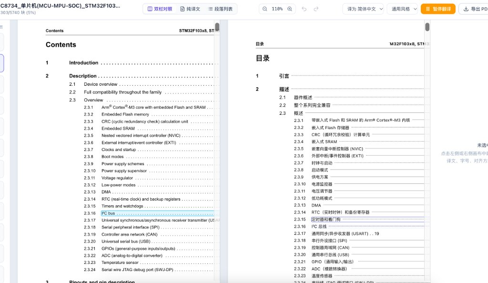

# TransLeaf

一款本地运行的 AI 高保真 PDF 文档翻译与对照校对工具，在翻译文本的同时尽量保持原文档的版式、图表、颜色与字体风格。

## 效果预览



## 主要功能

- **保留原版排版**：完整保留原 PDF 的目录结构、图表图形、颜色、字号、字体风格与对齐方式。
- **双栏实时对照**：支持「双栏对照」「纯译文」「段落列表」三种视图切换，点击段落即可原文与译文同步高亮定位。
- **灵活翻译控制**：支持整篇翻译、指定页码或页码范围翻译、单页一键翻译，可随时暂停与继续。
- **所见即所得微调**：支持双击原地编辑译文、拖拽调整文本框大小，以及微调字号、对齐方式或单段重译。
- **高保真导出**：校对完成后可一键导出保持原版排版的翻译后 PDF 文档。
- **自定义模型接入**：支持接入各类 OpenAI 兼容接口的大模型服务（如 OpenAI、DeepSeek、本地 Ollama 等）。

## 快速开始

### 1. 启动后端

```bash
cd backend
go run ./cmd/server
```

后端默认运行在 `http://127.0.0.1:8080`。

### 2. 启动前端

```bash
cd frontend
npm install
npm run dev
```

启动后在浏览器访问 `http://localhost:5173`，在界面右上角配置模型 API Key 后即可上传 PDF 开始翻译。
