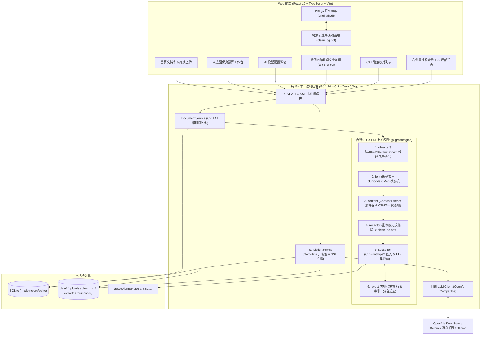
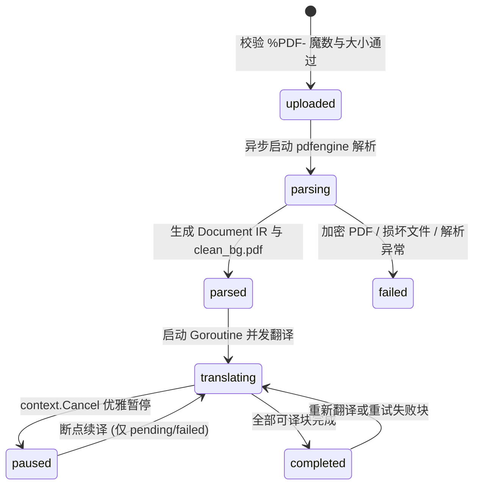
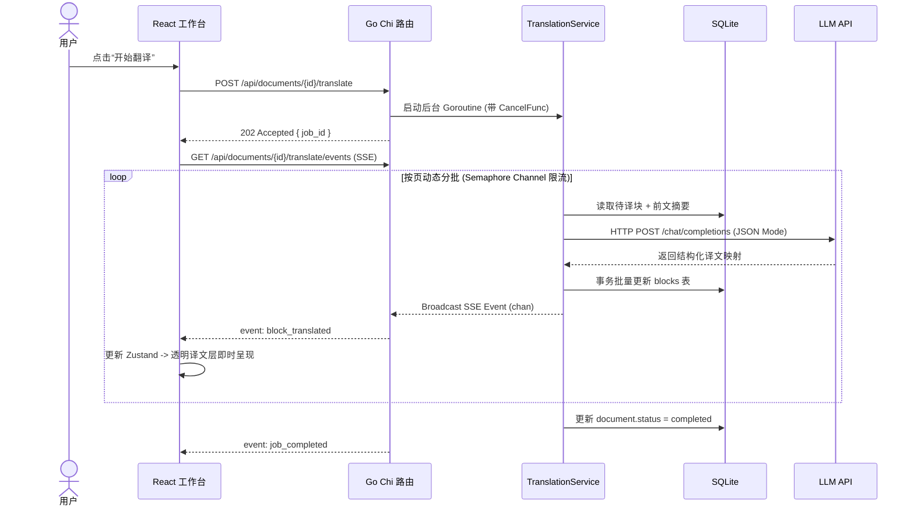
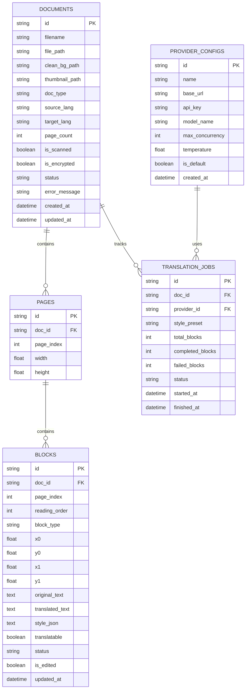

# 系统架构与详细设计说明书（Design Specification）

- **项目名称**：TranslationAssistant（AI 高保真文档翻译助手）
- **关联文档**：[requirements.md](file:///Users/qymlxin/.gemini/antigravity/brain/e8d631fc-d771-4fd6-99fb-69af986d1561/requirements.md)
- **文档版本**：v2.0（纯 Go 自研 PDF 引擎 + 全栈商业友好开源协议版）

---

## 1. 全栈技术栈与开源协议合规审计表

本项目所有依赖均经过严格开源协议审查，**零 AGPL / GPL / 商业授权风险**，可自由用于开源或闭源商业化：

| 层级 | 组件 / 库 | 开源协议 | 用途说明 |
| :--- | :--- | :--- | :--- |
| **后端运行时** | Go 1.24 标准库 | BSD-3-Clause | HTTP 服务、并发调度、压缩流、二进制编解码 |
| **核心 PDF 引擎** | **自研 `pkg/pdfengine`** | **自有版权** | 纯 Go 实现 PDF 对象解析、CMap 解码、状态机、无损擦除、字体嵌入与排版 |
| **字体度量解析** | `golang.org/x/image/font/sfnt` | BSD-3-Clause | Go 官方扩展库，解析 TTF/OTF 字形索引与精确前进宽度 |
| **文本编码辅助** | `golang.org/x/text` | BSD-3-Clause | Go 官方扩展库，UTF-16BE / CJK 字符编码转换 |
| **HTTP 路由** | `github.com/go-chi/chi/v5` | MIT | 轻量、完全兼容 `net/http` 标准库的路由器与中间件 |
| **本地数据库** | `modernc.org/sqlite` | BSD-3-Clause | **纯 Go 零 CGo** SQLite 驱动，支持全平台无缝交叉编译 |
| **AI 客户端** | **自封装 `internal/llm`** | **自有版权** | 基于标准库 `net/http` 实现 OpenAI 兼容协议、超时与指数退避重试 |
| **内置中文字体** | Google `Noto Sans SC` | SIL OFL-1.1 | 免费可商用开源字体，允许子集嵌入 PDF |
| **前端框架** | React 19 + TypeScript + Vite | MIT / Apache-2.0 | 现代化强类型 Web 应用框架 |
| **前端样式与图标** | Tailwind CSS v4 + Lucide React | MIT / ISC | 工作台 UI 样式与矢量图标 |
| **前端状态管理** | Zustand | MIT | 细粒度块级状态更新 + 撤销/重做历史栈 |
| **前端 PDF 渲染** | `pdfjs-dist`（Mozilla PDF.js） | Apache-2.0 | 浏览器端矢量级高清渲染（原 PDF 与 `clean_bg.pdf`） |

---

## 2. 总体系统架构



### 核心亮点架构：`clean_bg.pdf` 双底图无损预览机制

传统 Web 翻译器在右侧预览时，需要用“纯色背景矩形”盖住原文，一旦原文压在**渐变背景、摄影底图或复杂表格线**上，就会出现难看的纯色补丁块。

本架构采用 **“解析即擦除”的双底图机制**：
1. 上传 `original.pdf` 后，后端自研 `pdfengine` 完成版面解析的同时，立即通过 `redactor` 指令级擦除所有 `translatable == true` 的文字绘图指令，输出一份 **纯净底图 `clean_bg.pdf`**（底层图片、矢量线、渐变色、公式、不可译页码 100% 保留）。
2. 前端工作台双栏对照时：
   - **左侧**由 `PDF.js` 渲染 `original.pdf`；
   - **右侧**由 `PDF.js` 渲染 `clean_bg.pdf`，并在其上方铺设**背景全透明**的可编辑译文 DOM 叠加层！
3. **收益**：Web 编辑预览态与最终导出 PDF 达到 **100% 视觉同源一致**，且彻底免去了后端光栅化背景色采样的需求。

---

## 3. 自研纯 Go PDF 引擎（`pkg/pdfengine`）深度设计

```text
backend/pkg/pdfengine/
├── engine.go          # 引擎统一对外门面（Parse / GenerateCleanBg / ExportTranslated / ExportBilingual）
├── object/            # 模块 1：PDF 底层对象模型、词法解析、XRef 表/流、增量写入器
│   ├── types.go       # Null, Bool, Int, Real, Name, String, Array, Dict, Stream, IndirectRef
│   ├── lexer.go       # PDF 字节流词法扫描器
│   ├── parser.go      # Trailer / XRef Table / XRef Stream / Object Stream (ObjStm) 解析
│   ├── filter.go      # FlateDecode (含 PNG/TIFF Predictor), ASCII85, ASCIIHex 解压与压缩
│   └── writer.go      # PDF 对象修改与重构序列化写入器（生成合法 XRef 与 Trailer）
├── font/              # 模块 2：字体编码与 CMap 解码器
│   ├── cmap.go        # ToUnicode CMap 解析器 (beginbfchar / beginbfrange / codespacerange)
│   ├── encoding.go    # WinAnsi / MacRoman / Standard / Differences 编码映射表
│   └── resolver.go    # 字体字典解析，识别 Type0/TrueType/Type1 与不可解码数学字体
├── content/           # 模块 3：Content Stream 解释器与版面重构
│   ├── tokenizer.go   # 绘图操作符流 Token 解析 (Operands + Operator)
│   ├── state.go       # 图形状态栈 (q/Q, CTM 矩阵, Tm/Tlm 文本矩阵, Font, FontSize, FillColor)
│   ├── extractor.go   # 提取每个 Glyph/Span 精确 BBox，支持递归进入 Form XObject (Do)
│   └── layout_merge.go# 同段落合并、连字符还原、X 轴投影双栏排序、非可译块启发式过滤
├── redactor/          # 模块 4：指令级无损文字擦除器
│   └── redactor.go    # 精准剔除/切分落入目标 BBox 的 Tj/TJ/'/" 指令，100% 保留图片与矢量路径
├── subsetter/         # 模块 5：中文字体嵌入与 TrueType 子集化
│   ├── cidfont.go     # 构建 Type0 + CIDFontType2 + FontDescriptor + Identity-H ToUnicode 流
│   └── ttf_subset.go  # （M2b）解析并裁剪 TTF 表 (head/hhea/hmtx/maxp/loca/glyf/cmap/post) 压缩体积
└── layout/            # 模块 6：中英文混排折行与自适应排版回填器
    ├── measure.go     # 基于 sfnt 精确计算中英文字符前进宽度
    ├── typesetter.go  # 中英混排折行、标点避头尾、左/中/右/两端对齐、字号二分缩放防溢出
    └── emitter.go     # 生成标准 PDF Content Stream (BT ... Tf ... Tm ... <hex> Tj ... ET)
```

### 关键算法核心逻辑

1. **指令级无损擦除（`redactor.go`）**：
   - 解析页面（及被引用 Form XObject）的 Content Stream 为 `[]Operation`。
   - 同步推进图形状态机，遇到非文本操作（`m`, `l`, `c`, `re`, `S`, `f`, `Do`, `q`, `Q`, `cm`, `rg`, `RG`, `gs` 等）**无条件原样写入输出操作序列**。
   - 遇到文本绘制操作（`Tj`, `TJ`, `'`, `"`）时，逐字形计算其在页面坐标系下的中心点 `(cx, cy)`：
     - 若所有字形均落入待擦除 `redactRects`，直接丢弃该绘图指令（保留必要的文本矩阵推进以防影响后续未擦除文字）；
     - 若部分落入（如行内混合保留的数学符号与普通文字），拆分 `TJ` 数组，仅移除落入框内的字形并用数值偏移补齐剩余字形位置！
   - 若某页面存在修改，将新操作序列重新压缩为 `FlateDecode` 流替换页面 `/Contents`。

2. **中英文混排折行与自适应字号（`typesetter.go`）**：
   - 输入：`translatedText`、`bbox [x0, y0, x1, y1]`、`style (fontSize, lineHeight, align, color)`、`sfnt.Font`。
   - 折行规则：英文单词按空格/连字符成词不可强行断在词中（超宽单词除外），中文字符按字折行并处理基本标点避头尾（如 `，。！？；：）】》` 不落行首）。
   - 自适应二分缩放：从 `targetSize = style.TranslatedFontSize` 开始计算总排版高度 `totalH`；若 `totalH > boxHeight`，在 `[max(6.0, targetSize * 0.6), targetSize]` 区间内进行二分搜索，找到能完整容纳的最大字号。
   - 坐标转换：PDF 内部坐标系原点在页面**左下角**（Y 轴向上），而 Document IR 统一采用**左上角原点**（与前端 CSS 和阅读习惯一致），`emitter.go` 写入时执行 `pdfY = pageHeight - irY` 精确换算。

3. **双语对照 PDF 拼装（`engine.go`）**：
   - **交替页模式**：构造新 PDF 的 `/Pages` 树，将 `original.pdf` 与 `translated.pdf` 的页面对象重编号后交替追加。
   - **左右并排模式**：将原页和译文页各自封装为两个 `Form XObject`（`/BBox [0 0 W H]`），新建宽为 `2*W` 的页面，通过 `q 1 0 0 1 0 0 cm /Orig Do Q` 与 `q 1 0 0 1 W 0 cm /Trans Do Q` 左右无损拼装并绘制中缝分割线。

---

## 4. 核心数据流与状态机

### 4.1 文档状态机



### 4.2 流式并发翻译时序图



---

## 5. 数据模型设计

### 5.1 SQLite 数据库 ER 图



---

## 6. REST API 与 SSE 接口契约

| 分组 | Method | Path | 说明 |
| :--- | :--- | :--- | :--- |
| **系统** | `GET` | `/api/health` | 服务健康检查 |
| **文档管理** | `POST` | `/api/documents/upload` | 上传 PDF，校验魔数与大小，异步触发 `pdfengine` 解析与 `clean_bg.pdf` 生成 |
| | `GET` | `/api/documents` | 获取文档列表与翻译进度统计 |
| | `GET` | `/api/documents/{id}` | 获取完整 Document IR（含各页及所有文本块） |
| | `GET` | `/api/documents/{id}/file` | 流式返回原始 `original.pdf`（左侧 PDF.js 加载） |
| | `GET` | `/api/documents/{id}/clean-bg` | 流式返回无损擦除底图 `clean_bg.pdf`（右侧 PDF.js 加载） |
| | `GET` | `/api/documents/{id}/thumbnail` | 获取首页 PNG 缩略图 |
| | `PUT` | `/api/documents/{id}/thumbnail` | 接收前端 PDF.js 渲染回传的首页缩略图缓存 |
| | `DELETE` | `/api/documents/{id}` | 级联删除数据库记录与本地磁盘文件 |
| **块级编辑** | `PATCH` | `/api/documents/{id}/blocks/{block_id}` | 更新译文、样式、`bbox`、`translatable` 或审校状态；若修改 `translatable` 自动刷新对应页 `clean_bg.pdf` |
| | `POST` | `/api/documents/{id}/blocks/{block_id}/retranslate` | 单块 AI 局部重译 / 润色 / 精简 |
| **翻译调度** | `POST` | `/api/documents/{id}/translate` | 启动/续译任务 |
| | `POST` | `/api/documents/{id}/translate/pause` | 暂停翻译任务 |
| | `GET` | `/api/documents/{id}/translate/events` | SSE 实时事件流（`block_translated` / `block_failed` / `job_completed`） |
| **导出** | `POST` | `/api/documents/{id}/export` | 生成并返回保真 PDF（`translated` \| `bilingual_interleaved` \| `bilingual_side_by_side`） |
| **模型配置** | `GET/POST/PUT/DELETE` | `/api/providers[/{id}]` | 模型配置 CRUD（返回时 API Key 掩码脱敏） |
| | `POST` | `/api/providers/test` | 10 秒超时连通性探针 |

---

## 7. Web 端原型与交互设计

### 7.1 工作台双底图无损对照原型（`WorkspacePage`）

```text
+---------------------------------------------------------------------------------------------+
| [← 返回] attention_paper.pdf | [双栏对照 | 纯译文 | 段落列表] | [- 100% +] | [▶ 开始翻译] [导出▾] |
+------------+----------------------------------------+---------------------------------------+
|  页面导航   |     原版 PDF (original.pdf 渲染)        |   纯净底图 (clean_bg.pdf) + 透明译文层  | 右侧检查器
|            |                                        |                                       +------------------+
|  +------+  |  +----------------------------------+  |  +----------------------------------+ | 块属性 (#p0_b3)  |
|  | P1   |  |  |  Attention Is All You Need       |  |  |  注意力机制即是一切               | | 状态: [已翻译]   |
|  +------+  |  |                                  |  |  |                                  | |                  |
|  +------+  |  |  [蓝色高亮框]                     |  |  |  [蓝色虚线编辑框 + 拖拽角点]     | | 原文 (只读):     |
|  | P2 * |  |  |  The dominant sequence           |  |  |  主流的序列转换模型基于          | | The dominant...  |
|  +------+  |  |  transduction models are...      |  |  |  复杂的循环或卷积神经网络...     | |                  |
|  +------+  |  |                                  |  |  |  (背景全透明,底图/表格线100%保留) | | 译文 (实时编辑): |
|  | P3   |  |  |       [原版架构图 100% 保留]      |  |  |       [原版架构图 100% 保留]      | | +--------------+ |
|  +------+  |  |                                  |  |  |                                  | | | 主流的序列... | |
|            |  |  Left col...    Right col...     |  |  |  左栏译文...    右栏译文...       | | +--------------+ |
|  进度:     |  +----------------------------------+  |  +----------------------------------+ | [✨ AI 润色/重译] |
|  12/15 页  |                                        |                                       | 指令: [精简排版▾]|
|  [====== ] |                                        |                                       | 字号: [- 10.5 +] |
|            |                                        |                                       | 行高: [1.25   ▾] |
|            |                                        |                                       | 对齐: [左|中|右] |
|            |                                        |                                       | [✓] 参与翻译     |
+------------+----------------------------------------+---------------------------------------+
```

### 7.2 项目工程目录规划

```text
TranslationAssistant/
├── README.md
├── docs/specs/                # 同步沉淀 SDD 三件套
├── backend/                   # 纯 Go 1.24 后端（零 CGo）
│   ├── go.mod
│   ├── assets/fonts/          # NotoSansSC-Regular.ttf / Bold.ttf (SIL OFL-1.1)
│   ├── cmd/server/main.go     # 服务启动入口
│   ├── pkg/pdfengine/         # ★ 自研纯 Go PDF 保真引擎（可独立开源复用）
│   │   ├── object/            # PDF 对象/XRef/Stream 解析与写入
│   │   ├── font/              # 字体编码与 ToUnicode CMap 解码
│   │   ├── content/           # Content Stream 状态机与版面合并
│   │   ├── redactor/          # 指令级无损文字擦除
│   │   ├── subsetter/         # CIDFontType2 嵌入与 TTF 子集裁剪
│   │   └── layout/            # 中英混排折行与自适应字号排版
│   └── internal/
│       ├── config/            # 环境变量与目录管理
│       ├── store/             # SQLite 初始化与 Repository
│       ├── model/             # Go Domain Struct 与 Document IR
│       ├── adapter/           # 插件化 DocumentParser / DocumentExporter 接口（预留 DOCX/PPTX）
│       ├── llm/               # OpenAI 兼容客户端
│       ├── service/           # 文档服务、并发翻译调度、SSE 事件中心
│       └── api/               # Chi HTTP Handlers & 中间件
└── frontend/                  # React 19 + TypeScript + Vite 前端
    └── src/                   # 页面、双底图 PDF.js 视图、透明译文编辑层、CAT 列表、模型配置
```
